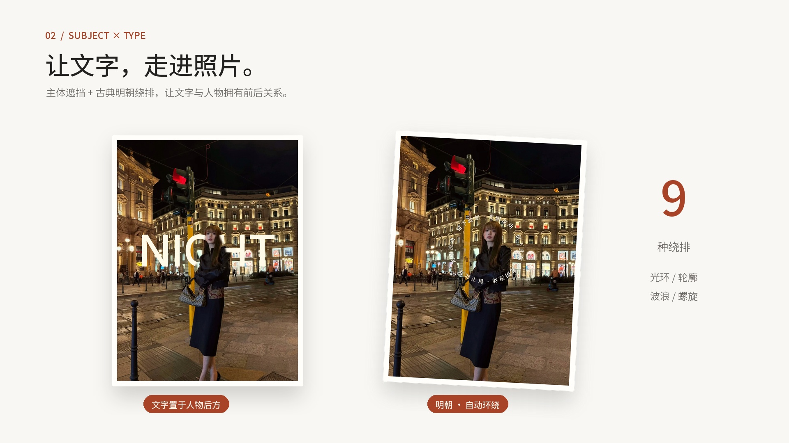

<div align="center">

# DARKROOM

**一张照片，一个本地运行的数字暗房。**

`LOCAL-FIRST` · `NON-DESTRUCTIVE` · `CANVAS + WEBGL2` · `WASM INFERENCE`

[30 秒演示](media/darkroom-demo.mp4) · [快速启动](#boot) · [功能手册](docs/FEATURES.md) · [能力边界](#known-limits)

[](media/darkroom-demo.mp4)

</div>

```text
$ darkroom --develop your-memories

  INPUT      photograph / Live Photo / motion photo / .livp / short video
  PROCESS    compose → grade → wrap → layer → develop
  STORAGE    IndexedDB on your device
  OUTPUT     JPG / PNG / WebP / iPhone Live pair / Android Motion Photo / MP4

  No API key. No account. Your browser is the lab.
```

DARKROOM 把照片编辑器做成一间可操作的暗房：装入胶卷，看色彩显影；把明朝文字绕在人物周围；贴上一枚朱印，重排整张照片。熄灯后，工具退场，作品留在桌上。

原始照片与编辑参数分开保存。大胆试，随时撤销，或者一键回到底片。

## 30 seconds in the lab

**[▶ 播放功能演示 · 30 秒 / 1080p](media/darkroom-demo.mp4)**

以同一张照片展示五个特色：**主体识别与智能构图 → 人物遮挡文字与明朝绕排 → AI 深度与 2.5D 视差 → 保留胶片的跨结构版式 → 胶卷显影**。浅色版式展示与深色空间动效交替，直接对比功能的实际效果。照片、分割结果、深度图和 72 帧视差序列均来自 DARKROOM 的真实渲染；标题、检测框和镜头编排为视频合成。中文文案配原创电子音乐。

> GitHub 仓库内的 MP4 链接不一定直接内嵌播放；点击封面打开文件，或下载后播放。

<a id="boot"></a>
## Boot

需要 Python 3，以及支持 Canvas / WebGL2 / WebAssembly 的现代浏览器。解压后进入项目根目录：

```bash
cd darkroom
python3 serve.py 5180
# open http://localhost:5180
```

没有应用构建步骤。没有 npm 运行时依赖。`serve.py` 是本地静态服务器，附带 COOP / COEP 响应头，为支持的浏览器启用多线程 WASM。不要直接双击 `index.html`。

内置示例可直接体验，也可以拖入自己的照片。源码包包含前端推理运行时与模型；字体仍从 Google Fonts 获取，离线时可能使用回退字体。照片编辑与模型推理在浏览器内进行，无需图像上传 API。

## The control surface

| 能力 | 可以做什么 |
| :--- | :--- |
| **Film shelf** | 9 个胶卷选项，含原片；一键装载色彩、颗粒、暗角和漏光，曲线与参数继续微调 |
| **Type around life** | 14 个字体包，含 6 组明朝 / 书法；光环、轮廓、绕排、弧线、双列、螺旋、波浪、四边、放射 |
| **Break the layout** | 12 种版式，切换画幅、留白和层级；锁定想保留的维度，再 Roll |
| **Make it yours** | 28 种内置贴纸；自定义 PNG / JPG / WebP / SVG 导入、透明度、缩放、旋转与图层排序 |
| **Develop locally** | 主体检测与分割、深度估计、补全 / 消除；透视、景深和 2.5D 空间效果 |
| **Keep the moment moving** | 自动识别安卓动态照片、iPhone HEIC/JPG + MOV、.livp / ZIP 实况包；时间轴、片段裁剪、封面；导出 iPhone 实况（JPG + MOV，Apple Content ID）、安卓 Motion Photo 单文件 JPG、H.264 MP4 |
| **Into the darkroom** | 沉浸式灵感页：首屏显影、六章滚动叙事，每章一枚暗房贴纸（胶卷、放大镜、朱印、拍立得、实况、计时器）逐一贴上作品；放大机台式冲洗入口与显影过渡；片夹为一卷可向下拉出的 35 mm 胶片 |
| **Pocket darkroom** | 手机端全屏编辑：底部工具栏 + 可拖动参数抽屉、双指缩放构图、长按对比原片、底部弹层菜单，导出后可直接「存储到相册 / 分享」 |
| **Work in batches** | 片夹、同步设置、批量风格、拼贴、批量 ZIP 导出 |
| **Lights out** | 隐去工具面板，保留作品与胶卷架；一键还原，撤销找回 |

## Pixels are a pipeline

```text
source blob ──────────────────────────────────────┐
     │                                           │
     ▼                                           │ untouched original
 perspective → 2.5D → crop → optics → film       │
     → local adjustments → canvas → layers       │
     │                                           │
     ▼                                           ▼
 render(doc, media) → preview / export        reset + history
                           │
                           └── IndexedDB: source + assets + edit document
```

编辑文档描述“如何显影”，而不是反复覆盖原图。`render.js` 统一处理预览和静态导出；Live 视频逐帧复用兼容的渲染步骤。图层与生成底片引用独立资源，版本历史保存文档快照。

```text
.
├── index.html          # app shell
├── serve.py            # static HTTP + cross-origin isolation
├── css/app.css         # darkroom interface
├── js/
│   ├── app.js          # navigation, history, canvas interaction
│   ├── render.js       # rendering pipeline
│   ├── color.js        # curves, film, grain, bloom
│   ├── gl.js           # perspective & depth reprojection
│   ├── flow.js         # subject-aware type geometry
│   ├── layers.js       # text, stickers, shapes, photo cards
│   ├── templates.js    # editable layout recipes
│   ├── live.js         # live import, timeline, export flow
│   ├── livefmt.js      # motion-photo / Live Photo containers, WebCodecs + MP4/MOV muxer
│   ├── stickers.js     # die-cut darkroom stickers (SVG)
│   ├── mobile.js       # phone editor: tool sheet, pinch, hold-to-compare
│   ├── media.js        # source assets & inference results
│   ├── store.js        # IndexedDB persistence
│   └── ml/             # detection, segmentation, ONNX worker
├── assets/models/      # local inference weights
├── vendor/             # MediaPipe & ONNX Runtime Web
├── media/              # demo video, cover & reproducible motion project
├── docs/FEATURES.md     # detailed feature manual
└── tests/              # browser workflow & rendering checks
```

## Render the story

视频工程与所用应用截图、字体许可、原始配乐一起保存在 `media/production/`。需要 Python 3、Pillow、NumPy 和 FFmpeg：

```bash
python3 -m pip install pillow numpy
python3 media/production/render.py --stills  # 分镜检查
python3 media/production/render.py           # 30s / 1080p / 30fps
```

动画由确定的时间函数驱动，可直接修改镜头时间段、文案、图片轨迹与配乐；重新运行会替换 `media/darkroom-demo.mp4`。详见 [视频工程说明](media/production/README.md)。

## Under the hood

Vanilla ES modules · Canvas 2D · WebGL2 · Web Workers · IndexedDB · MediaRecorder · MediaPipe Tasks Vision · ONNX Runtime Web.

| Local model | Job |
| :--- | :--- |
| EfficientDet-Lite0 | 主体检测 |
| DeepLab v3 | 主体分割 |
| Depth Anything V2 Small · int8 ONNX | 深度估计 |
| MI-GAN pipeline v2 | 图像补全、消除与扩图 |

文案模块根据场景、对象和风格组合内置文本模板，**并非在线大语言模型**。单帧推导的景深与相机运动是视觉模拟，不是恢复真实拍摄参数。

## Keyboard-driven

| Key | Action |
| :--- | :--- |
| `1` … `9` | 切换工具 |
| Hold `Space` | 对比原片 |
| `⌘/Ctrl + Z` | 撤销 |
| `⇧ + ⌘/Ctrl + Z` | 重做 |
| `R` | Roll |
| `Esc` | 退出熄灯模式 |

<a id="known-limits"></a>
## Known limits — no magic claims

- **Live 导出是标准容器，不是相机原生直出。** 安卓 Motion Photo 按 Google Motion Photo v1 写入 XMP 目录与内嵌 MP4；iPhone 实况为 JPG（Apple MakerNote ContentIdentifier）+ QuickTime MOV（同一 Content ID + still-image-time 元数据轨）。格式已用 exiftool / FFmpeg 解析校验，但各品牌相册与 iOS「存储到相册」是否识别为实况，仍需真机验收。实况视频无声音。
- 实况导出需要 WebCodecs H.264（新版 Chrome / Edge / Safari 16.4+）；不支持时只能导出普通视频。动态部分最长 15 秒，1080p / 720p，≤6 秒为 30fps，更长为 24fps。
- iPhone 相册选图只会给网页静态图。完整实况需在「照片」分享 → 选项 → 打开「所有照片数据」后存到「文件」，再从「文件」导入；或使用 .livp / iCloud ZIP。
- 静态 AI 消除、扩图、景深、主体 / 深度 / 画笔蒙版和 2.5D 不套到整段 Live 视频。HEIC / HEVC 能否读取取决于浏览器，可转换为 JPG / H.264 MP4。
- IndexedDB 属于浏览器站点数据。清理站点数据会移除本地项目；导出成片后请自行备份。ZIP 成片包不是完整可恢复的项目备份。
- 导出静态图片不保留 EXIF / GPS。胶片名称为自有命名，不是品牌官方模拟。
- 内置模型、运行时、字体与示例素材各自的许可独立适用；本仓库未统一声明开源许可证。对外发布前应核对第三方素材授权。

## Verification

已在 Chromium 验证：iPhone 配对 / 动态 JPG / LIVP 导入，三种实况格式导出与回读（`tests/live-formats.mjs`），手机端抽屉、双指缩放与长按对比；胶卷替换、贴纸持久化、版式切换、底片还原 / 撤销、Live 导入 / 封面 / 播放 / 导出，以及 9 种绕排与 28 种贴纸渲染。真实设备、Safari 和不同来源的 Live 文件仍需实机验收。

测试脚本目前使用开发工作区相邻 `red-room` 项目的 `puppeteer-core` 与系统 Chromium 路径。独立运行时，需要安装 `puppeteer-core` 并调整脚本导入路径及浏览器路径；不影响网站启动。

---

<div align="center">

**Keep the negative. Change the expression.**

底片不变，表达自由。

</div>
